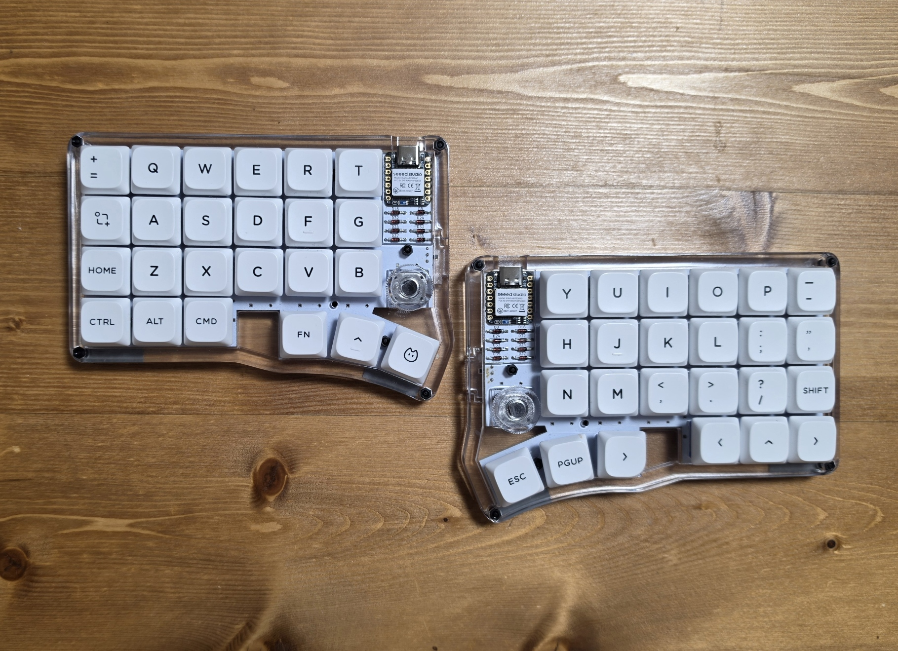

# Ortholinix

<p align="center">
  
</p>

Ortholinix は、左右分割型のワイヤレス自作キーボードです。

このリポジトリには、ZMK ファームウェア、KiCad の基板設計データ、FreeCAD のケース設計データが含まれています。

> [!NOTE]
> 個人製作の設計データです。製造・組み立て前に、基板データ、部品の向き、ケース寸法などを自身の環境で確認してください。

## 特徴

- 左右分割、全 50 キー
- Seeed Studio XIAO nRF52840（`seeeduino_xiao_ble`）を左右に使用
- ZMK による Bluetooth 接続
- Kailh Choc V2 対応ホットスワップソケット
- 左右それぞれに押し込み対応ロータリーエンコーダー
- ZMK Studio 対応（左側／Central）
- バッテリー残量表示および右側バッテリー残量のプロキシ表示
- KiCad 9 形式の左右別 PCB データ
- FreeCAD 原本と、左右別・部品別の STEP データ

## リポジトリ構成

```text
.
├── .github/workflows/build.yml       # ZMK の自動ビルド
├── boards/shields/ortholinix/        # シールド定義、キーマップ、左右の設定
├── build.yaml                        # GitHub Actions のビルド対象
├── cases/
│   ├── ortholinix.FCStd              # FreeCAD のケース設計原本
│   └── models/                       # 左右の TopCover / TopPlate / BackPlate（STEP）
├── config/west.yml                   # ZMK / west マニフェスト
└── kicad/
    ├── left/                         # 左手側の回路図・PCB・ライブラリ
    └── right/                        # 右手側の回路図・PCB・ライブラリ
```

## ファームウェア

### GitHub Actions でビルドする

`main` ブランチへの push、Pull Request、または手動実行で `.github/workflows/build.yml` が起動します。

1. GitHub の **Actions** タブを開く
2. **Build ZMK firmware** の最新の成功した実行を開く
3. **Artifacts** からファームウェアをダウンロードする
4. ZIP を展開し、左右それぞれの UF2 ファイルを使用する

`build.yaml` では次の組み合わせをビルドします。

| 用途 | Board | Shield |
| --- | --- | --- |
| 右手側 | `seeeduino_xiao_ble` | `ortholinix_right` |
| 左手側（Central） | `seeeduino_xiao_ble` | `ortholinix_left` |
| 設定消去 | `seeeduino_xiao_ble` | `settings_reset` |

左右の通常ファームウェアには `studio-rpc-usb-uart` snippet が指定されています。

### 書き込む

1. XIAO nRF52840 を USB で PC に接続する
2. RESET を素早く 2 回操作してブートローダーモードにする
3. 表示された USB ドライブへ、対応する `.uf2` ファイルをコピーする
4. 左右とも書き込み、電源を入れ直す
5. ホスト PC から `Ortholinix` を Bluetooth ペアリングする

左手側が Central となり、PC との接続を担当します。

ペアリング情報を消去したい場合は `settings_reset` の UF2 を対象側へ書き込み、その後で通常の左右用ファームウェアを書き戻してください。左右間の接続を初期化する場合は両側で行います。

### キーマップを変更する

キーマップは [`boards/shields/ortholinix/ortholinix.keymap`](boards/shields/ortholinix/ortholinix.keymap) にあります。編集して push すると GitHub Actions が新しいファームウェアを生成します。

現在はベースレイヤーと 7 個の Fn レイヤーを定義しています。ロータリーエンコーダーは、左側が上下キー、右側が音量操作です。

## 基板データ

KiCad のプロジェクトは左右で分かれています。

- 左手側: [`kicad/left/ortholinix_left.kicad_pro`](kicad/left/ortholinix_left.kicad_pro)
- 右手側: [`kicad/right/ortholinix_right.kicad_pro`](kicad/right/ortholinix_right.kicad_pro)

回路図、PCB、およびプロジェクト内で使用するシンボル／フットプリントライブラリを各ディレクトリに収録しています。ファイルは KiCad 9 形式です。

Gerber や BOM はリポジトリに含まれていません。発注時は KiCad で設計ルールチェックを行い、使用する基板メーカーの仕様に合わせて出力してください。

## ケースデータ

ケースの編集には [`cases/ortholinix.FCStd`](cases/ortholinix.FCStd) を使用します。`cases/models/` には次の STEP データがあります。

- `ortholinix-TopCover_left.step` / `ortholinix-TopCover_right.step`
- `ortholinix-TopPlate_left.step` / `ortholinix-TopPlate_right.step`
- `ortholinix-BackPlate_left.step` / `ortholinix-BackPlate_right.step`

プリント前に、使用するプリンター、材料、スイッチ、ネジ、基板の実寸に合わせてクリアランスを確認してください。

## カスタマイズ時の主なファイル

| 変更内容 | ファイル |
| --- | --- |
| キー配置・レイヤー | `boards/shields/ortholinix/ortholinix.keymap` |
| GPIO・エンコーダー | `boards/shields/ortholinix/ortholinix.dtsi`、左右の `.overlay` |
| Bluetooth・ZMK Studio・バッテリー設定 | 左右の `.conf` |
| ビルド対象 | `build.yaml` |
| PCB | `kicad/left/`、`kicad/right/` |
| ケース | `cases/ortholinix.FCStd` |

## 関連リンク

- [ZMK Firmware](https://zmk.dev/)
- [ZMK Studio](https://zmk.dev/docs/features/studio)
- [Seeed Studio XIAO nRF52840](https://wiki.seeedstudio.com/XIAO_BLE/)
- [KiCad](https://www.kicad.org/)
- [FreeCAD](https://www.freecad.org/)
